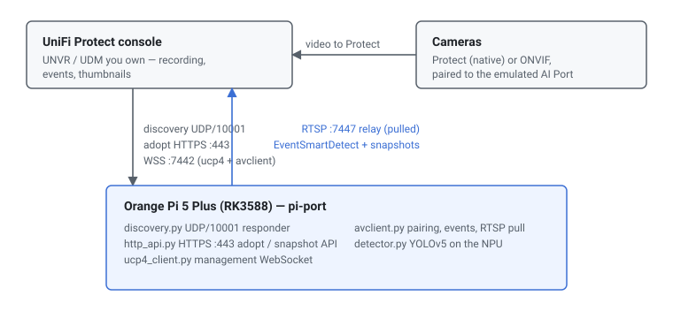

# pi-port — a DIY UniFi Protect "AI Port" (Orange Pi · Raspberry Pi · x86)

<div align="center">

<a href="LICENSE"></a>
<a href="https://github.com/hutchx86/pi-port/actions/workflows/ci.yml"></a>

**A reverse-engineering / interoperability proof of concept that makes a stock
SBC or PC present itself to a real UniFi Protect console as genuine AI Port
hardware (catalog model `UVC AI Port`, sysid `0xa5f1`).**
**It speaks the vendor wire protocol only — discovery, adoption, camera pairing,
video relay, object detection and detection events with thumbnails — with no
firmware modification, no controller database writes and no Ubiquiti code or
binaries.**

</div>

> [!WARNING]
> Proof of concept, not production software. It binds privileged ports
> (UDP/10001, TCP/443) and manages macvlan interfaces and DHCP leases;
> misconfiguration can disrupt your network or device. Use it only on hardware
> and consoles you own. See [Disclaimer](#disclaimer).

> [!NOTE]
> Not affiliated with, endorsed by, or connected to Ubiquiti Inc. "UniFi",
> "UniFi Protect" and "AI Port" are trademarks of Ubiquiti Inc. No Ubiquiti
> firmware or binaries are distributed here. Built with AI assistance under
> human review — verify anything you rely on. See [Legal](#legal).

## Quick start

```bash
git clone https://github.com/hutchx86/pi-port && cd pi-port

# Orange Pi 5 Plus (RK3588, NPU):
sudo scripts/install.sh --console <console-ip> [--parent-iface <iface>]

# ...or any CPU host (x86_64 / Raspberry Pi 4/5) with Docker:
AIPORT_CONSOLE_HOST=<console-ip> docker compose up -d --build

# then adopt "AI Port" in Protect and pair a camera to it
```

## At a glance

|  |  |
| --- | --- |
| **What** | Emulates the UniFi Protect AI Port device role |
| **Hardware** | Orange Pi 5 Plus (RK3588, NPU) — verified live; x86_64 + Raspberry Pi 4/5 (CPU, Docker) |
| **Protocol / interface** | UBNT discovery UDP/10001; mTLS WSS :7442 (`ucp4` + classic avclient); RTSP relay :7447 |
| **Detection** | Stock YOLOv5 (person/vehicle/animal) — RKNN on the RK3588 NPU, or `onnxruntime` on CPU |
| **Language** | Python 3 |
| **License** | AGPL-3.0-or-later |

## How it compares

|  | Real AI Port | Pi Port |
| --- | --- | --- |
| **What it is** | Ubiquiti AI Port appliance (Ambarella) | This repo's Python, on an SBC/PC |
| **Firmware** | Ubiquiti, signed | None — the emulator itself |
| **Detection model** | Ubiquiti's own classifier | Stock YOLOv5 (person/vehicle/animal), RKNN or CPU |
| **Output** | Full Ubiquiti product behaviour | The subset this project implements |

It is a protocol-compatible stand-in built on the same shared camera/chime
middleware, not a clone of the device.

## How it works

The host answers the console's L2 discovery, then adopts like a classic camera
(`POST /api/1.2/manage` on HTTPS :443). It keeps two mTLS WebSocket connections
to the console — the generic `ucp4` channel for management RPCs, and the classic
avclient channel for camera pairing and detection events. When a camera is
paired, the console hands the host an RTSP URL on its own internal relay
(`:7447`); the host pulls that stream, runs YOLOv5 on the NPU or CPU, and pushes
`EventSmartDetect` events and snapshot uploads back to the console.



| Component | Role |
| --- | --- |
| `discovery.py` | UDP/10001 UBNT discovery responder |
| `http_api.py` | HTTPS :443 adopt / control / snapshot API |
| `ucp4_client.py` | Generic `ucp4` device-management WebSocket |
| `avclient.py` | Pairing, streaming and smart-detect WebSocket + detection loop |
| `detector.py` | YOLOv5 inference wrapper — RKNN NPU or `onnxruntime` CPU |
| `sysinfo_server.py` | Dev-box CPU/mem/GPU/NPU status page (`webui.html`) |
| `instance_manager.py`, `run_all.py` | Multi-instance orchestration |

## Supported hardware

| Model | SoC | Status | Notes |
| --- | --- | --- | --- |
| Orange Pi 5 Plus | RK3588 | Verified | Target board; NPU; 4 real cameras paired and streamed |
| Other RK3588 boards | RK3588 | Untested | The NPU and ffmpeg paths are RK3588-specific |
| x86_64 server / PC | amd64 | Verified | `docker/` CPU image; no NPU |
| Raspberry Pi 4 | BCM2711 | Verified | `docker/` image; H.264 hardware decode bare-metal only |
| Raspberry Pi 5 | BCM2712 | Untested | CPU image; **no H.264 hardware decoder** (software decode) |
| Mac (Apple silicon) | M-series | Verified | Bare metal only (Docker Desktop has no LAN L2); `onnxruntime` on the Neural Engine (Core ML) |

## Features

- **Emulated AI Port device role** — L2 discovery, adoption, and both WebSocket
  connections a real console expects.
- **Camera pairing and video relay** — pairs real cameras and pulls their stream
  from Protect's internal RTSP relay.
- **Real object detection** — YOLOv5 (person/vehicle/animal) on the RK3588 NPU
  (RKNN) or on CPU (`onnxruntime`), auto-selecting the backend at runtime.
- **Detection events with thumbnails** — `EventSmartDetect` with per-object
  snapshots and Full-FoV images, plus the overview/timeline thumbnails.
- **Multi-instance** — one reboot-surviving systemd unit and macvlan interface
  per instance on the board, or one container per host; each a distinct L2 device,
  with a small web UI.
- **Honest state handling** — reflects real adopted state and clears local state
  on the console's reset.

## Requirements

- An Orange Pi 5 Plus (RK3588) with root and `rknn-toolkit-lite2` for NPU
  inference; **or** any CPU host (x86_64 / Raspberry Pi 4/5) with Docker for the
  CPU `onnxruntime` path.
- A UniFi Protect console you own and control, on the same LAN.
- For model conversion: an x86_64 Linux host with `rknn-toolkit2` (the RKNN
  converter does not run on the board).

## Repository layout

```
piport/               the emulator
  discovery.py          UDP/10001 UBNT discovery responder
  http_api.py           HTTPS :443 adopt/control API
  ucp4_client.py        generic ucp4 device-management websocket
  avclient.py           pairing/streaming/smart-detect websocket + detection
  detector.py           YOLOv5 wrapper (RKNN NPU / onnxruntime CPU)
  sysinfo_server.py     dev-box CPU/mem/GPU/NPU status page (+ webui.html)
  models/               anchors + COCO labels (model binaries fetched, not stored)
  instance_manager.py / run_all.py   multi-instance orchestration
compose.yaml          CPU stack / Komodo Stack (host net; x86_64 + arm64)
compose.macvlan.yaml  same, but a dedicated LAN IP/MAC per container
docker/               CPU Dockerfile + smoke test + notes
scripts/              install.sh (board installer), fetch_models.py, helpers
rknn_convert/         YOLOv5s -> RKNN conversion recipe (x86 build host)
docs/images/          README diagram
```

Model binaries (`.onnx`/`.rknn`) and all Ubiquiti firmware are **not** stored
here; see [Model assets](#model-assets-not-tracked). `piport/README.md` has the
protocol detail and per-component notes.

## Install / Usage

### Orange Pi 5 Plus (RK3588)

`scripts/install.sh` does the whole stand-up on the board: system packages, a
venv + dependencies, model assets, the required `librknnrt.so` upgrade, a
reboot-surviving systemd instance (via `instance_manager.py`), and the web UI.

```bash
sudo scripts/install.sh --console <UNVR-IP> [--parent-iface <iface>]
```

- Run from the checkout root, as root. `--parent-iface` defaults to the
  auto-detected default-route NIC.
- The NPU model cannot be built on the Pi; build it on an x86 host
  (`scripts/fetch_models.py --convert`) or let the installer fetch it from
  `--rknn-url` / `PIPORT_RKNN_URL` / its default URL. `--rknn <path>` takes a
  local build, and a local `models-rknn/` submodule is also detected. Use
  `--no-npu` for a CPU-only protocol-stack install.
- Opens the web UI on `:8090` (`--webui-port` to change) for board stats and
  instance management.

Then, in Protect: adopt "AI Port" like any camera, and pair a real camera to it
from the camera's own settings page. Detections appear as dashboard events with
thumbnails, and the console's own person/vehicle/animal filters work.

`run_all.py` needs root (binds UDP/10001 and TCP/443) and must be able to send L2
broadcast/multicast on the LAN, so run it on the host, not in a NAT'd container.
It resolves its own interface's IP by default, so multiple instances on one box
don't collide on `:443`.

### x86 / Raspberry Pi (CPU Docker) and Komodo

`docker/` builds one CPU image (onnxruntime, no NPU) for `linux/amd64` and
`linux/arm64` (Pi 4/5). The repo-root `compose.yaml` is the single-instance stack
(host networking) and the **Komodo** Stack file:

```bash
docker build -f docker/Dockerfile -t piport-cpu .
AIPORT_CONSOLE_HOST=<console-ip> docker compose up -d --build
./docker/run-smoke-test.sh   # no console/camera needed
```

`compose.yaml` uses host networking (one instance per host: it shares the host's
`:443`/`UDP-10001`); `compose.macvlan.yaml` gives each container its own LAN
IP/MAC for several instances on one host. See [`docker/README.md`](docker/README.md)
for Komodo import, networking caveats, and the confirmed/untested matrix.

### Raspberry Pi (bare metal, optional)

The Docker stack above is the recommended Pi path and is the same command as
x86. Run bare metal only if you want the Pi 4's hardware H.264 decode (it stalls
inside a container) or no Docker. Differences from the RK3588 board: **no NPU**,
so install `onnxruntime` instead of `rknn-toolkit-lite2`, and there is **no
`.rknn`** — the CPU `yolov5n.onnx` is used.

```bash
sudo apt-get install -y ffmpeg python3-venv
python3 -m venv venv
venv/bin/pip install -r piport/requirements.txt onnxruntime
python3 scripts/fetch_models.py                 # downloads yolov5n.onnx
$EDITOR piport/aiport.cfg                        # set [console] host (+ identity)
sudo venv/bin/python piport/run_all.py --iface <iface> [--state-dir <dir>]
```

`detector.py` selects the onnxruntime backend automatically. On a **Pi 4** it also
enables `h264_v4l2m2m` hardware decode; on a **Pi 5** it does not (no H.264
hardware decoder — it software-decodes, which the faster CPU handles). For reboot
survival, wrap `run_all.py` in a systemd unit with `KillMode=control-group`:

```ini
[Unit]
Description=UniFi AI Port emulator
After=network-online.target
Wants=network-online.target
[Service]
Type=simple
ExecStart=/opt/pi-port/venv/bin/python /opt/pi-port/piport/run_all.py --iface <iface> --state-dir /var/lib/pi-port
Restart=on-failure
KillMode=control-group
[Install]
WantedBy=multi-user.target
```

### macOS (bare metal)

Verified on an Apple-silicon Mac (adopted, 3 cameras paired, detections with thumbnails).
Run it on the host: Docker Desktop's VM can't do the L2 discovery the console needs.
With no `/sys`, `/proc` or `ip`, `config.py` finds the interface, MAC and IP through
`route`, `networksetup` and `ifconfig` (`--iface en0` to pick one explicitly).
The detector runs on the Neural Engine through onnxruntime's Core ML provider
(~6.5 ms vs ~37 ms per frame on CPU, M1 Pro); `AIPORT_ORT_PROVIDER=cpu` forces CPU.

```bash
brew install ffmpeg
python3 -m venv venv
venv/bin/pip install -r piport/requirements.txt onnxruntime
python3 scripts/fetch_models.py                 # downloads yolov5n.onnx
$EDITOR piport/aiport.cfg                        # set [console] host (+ identity)
sudo caffeinate -is venv/bin/python piport/run_all.py --iface en0 --state-dir ~/.piport-state
```

`caffeinate -is` stops the Mac sleeping while it runs (a sleeping Mac drops off the console).

### Manual install

```bash
python3 scripts/fetch_models.py               # model assets (--convert builds the .rknn, x86)
pip install -r piport/requirements.txt        # + rknn-toolkit-lite2 (RK3588 NPU) or onnxruntime (CPU)
$EDITOR piport/aiport.cfg                     # device identity + console IP
sudo python3 piport/run_all.py --iface <iface>
```

### Multiple instances (board)

`instance_manager.py` creates one systemd unit per instance, each with its own
macvlan sub-interface, MAC, and DHCP lease — a distinct L2 device:

```bash
sudo python3 piport/instance_manager.py create lab2 --parent-iface <iface>
python3 piport/instance_manager.py list
sudo python3 piport/instance_manager.py destroy lab2
```

### Model assets (not tracked)

The detector needs an open YOLOv5 model. Because the binaries are large and
reproducible, they are not committed; `scripts/fetch_models.py` downloads them:

| Asset | Used by | Source |
| --- | --- | --- |
| `yolov5s_relu.onnx` (27.6 MiB) | RKNN conversion (`.rknn`) | Rockchip model zoo delivery: <https://ftrg.zbox.filez.com/v2/delivery/data/95f00b0fc900458ba134f8b180b3f7a1/examples/yolov5/yolov5s_relu.onnx> |
| `yolov5n.onnx` (3.8 MiB) | CPU detector (x86_64 / Pi) | Ultralytics release `v7.0`: <https://github.com/ultralytics/yolov5/releases/download/v7.0/yolov5n.onnx> |
| anchors, COCO labels, bus.jpg, calibration subset | RKNN conversion | <https://github.com/airockchip/rknn_model_zoo> (tag `v2.3.2`) |

The CPU backend uses Ultralytics `yolov5n.onnx` and still accepts the Rockchip
`yolov5s_relu.onnx` via `AIPORT_MODEL_PATH` (both layouts are auto-detected). The
Dockerfile downloads and sha256-verifies the CPU model at build time.

`yolov5s_relu.rknn` is produced on an x86_64 machine with `rknn-toolkit2`
(see `rknn_convert/convert.py` and `piport/README.md`):

```bash
python3 scripts/fetch_models.py --convert
```

`scripts/install.sh` resolves the prebuilt `.rknn` in order: `--rknn <path>`, a
local `models-rknn/` (submodule) or `rknn_convert/` copy, then a download from
`--rknn-url` / `PIPORT_RKNN_URL` / `DEFAULT_RKNN_URL` (always sha256-verified).
The default source is the separate AGPL-3.0 model repo
[`hutchx86/pi-port-models`](https://github.com/hutchx86/pi-port-models) (tag
`v1`); the model is never committed here.

**Model license.** The model derives from Ultralytics YOLOv5 (AGPL-3.0) via
Rockchip's model zoo (Apache-2.0), so any redistributed `.rknn` is an AGPL-3.0
work, the same license as this project. Include the AGPL-3.0 text and attribution
if you redistribute it; the corresponding source is this repo's conversion recipe
plus the ONNX above.

## Configuration

Device identity, network mode and the console address live in
`piport/aiport.cfg`; CLI flags on each script override it, and a small set of
`AIPORT_*` environment variables override it too (container-friendly).

| Key | Default | Meaning |
| --- | --- | --- |
| `[identity] mac` | derived | Device MAC (12 hex chars). Blank derives one from the interface's OUI |
| `[identity] platform` | `UVC AI Port` | Catalog model string the console matches (must be exact) |
| `[identity] sysid` | `0xa5f1` | Hardware/model id |
| `[identity] device_id` | per-instance | Persistent device UUID (must be unique per instance) |
| `[network] iface` / `mode` / `ip` | auto / `dhcp` / — | Interface to bind, and `dhcp` or `static` addressing |
| `[console] host` / `port` | — / `7442` | The Protect console to dial when not yet adopted |

Detector/runtime environment overrides: `AIPORT_BACKEND`, `AIPORT_MODEL_PATH`,
`AIPORT_OBJ_THRESH`, `AIPORT_HWDEC`, `AIPORT_ORT_INTRA_THREADS`, `AIPORT_ORT_PROVIDER`,
`AIPORT_MOTION_GATE` / `AIPORT_MOTION_GATE_THRESH` (see `piport/README.md`).

## Verification

- Unit suite (no hardware required):

  ```bash
  cd piport && python3 -m unittest discover -s tests
  ```

- Container smoke test (no console/camera required):

  ```bash
  ./docker/run-smoke-test.sh
  ```

- On-device: run the stack and watch it discover, adopt and pair (see
  `piport/README.md` and `scripts/live_watch.py`).

## Roadmap / known limitations

- **Known:** detection is stock YOLOv5 (person/vehicle/animal), not Ubiquiti's
  classifier; face, license-plate and vehicle-classification are not implemented.
- **Known:** on the Raspberry Pi 4 the H.264 hardware decoder is instance-limited
  and known-flaky; the Pi 5 has no H.264 hardware decoder at all. See
  `implementation.md` (CPU-x86 only) and `docker/README.md`.
- **Known:** the Pi 5 path is untested; the CPU container's live-camera path has
  only been smoke-tested.
- **Planned:** stress-testing beyond the four-camera live setup.

## Changelog

- **Unreleased** — CPU Docker image + Komodo stack (x86_64 / arm64); unified
  runtime-selected detector backend; Pi 4 hardware-decode + detector tuning.
- **2026-09** — Line Crossing; paired-camera snapshot retrieval over UCP4; the
  `connectionHost` upload fix; event/feature-flag dedupe; multi-instance systemd
  units and the web UI; one-shot `install.sh`; firmware-update faking.
- **2026-08** — initial protocol stack: discovery, adoption, both WebSocket
  connections, NPU detection and `EventSmartDetect` with thumbnails.

## Troubleshooting

<details>
<summary><b>Troubleshooting / operational notes</b></summary>

**A partial restart leaves stale connections.** Restart the full four-process
stack (discovery, adopt HTTP, ucp4, avclient). `run_all.py` starts all four
together.

**`pkill -f 'run_all.py'` kills itself.** Use the bracket trick, and kill
orphaned ffmpeg children too:

```bash
pkill -9 -f '[r]un_all.py'
pkill -9 -f '[f]fmpeg.*rtsp://<console-ip>:7447'
```

**Starting detached over SSH hangs.** Use
`setsid -f <command> >log 2>&1 </dev/null`.

**Multiple instances collide on `:443`.** Bind each instance to its own
interface's real IP (the default) rather than `0.0.0.0`.

</details>

## Credits

Special thanks to
[dciancu/unifi-protect-unvr-docker-arm64](https://github.com/dciancu/unifi-protect-unvr-docker-arm64)
— the inspiration for getting into UniFi tinkering, and whose methods helped in
learning how parts of it work. Protocol work was informed by the open-source
UniFi community; the detection model and conversion recipe come from Rockchip's
model zoo. Third-party components and licenses are listed in
[CREDITS.md](CREDITS.md).

<details>
<summary><b>Legal</b></summary>

- **Not affiliated with, or endorsed by, Ubiquiti Inc.** "UniFi", "UniFi
  Protect" and "AI Port" are trademarks of Ubiquiti Inc.
- **No Ubiquiti firmware or binaries are distributed here.** You supply your own
  console, cameras and (for reverse engineering) firmware images.
- Intended for interoperability and personal use on hardware and consoles you
  own. Reverse-engineering may be restricted in your jurisdiction, and you are
  responsible for how you use this. Nothing here targets third-party systems.

</details>

<details>
<summary><b>Disclaimer</b></summary>

**This is a proof-of-concept project, not a production-ready system.** Large
parts were produced with LLMs under human supervision, review, and real-hardware
testing — review and verify everything yourself. **This software is provided "as
is", without warranty of any kind.** It binds privileged ports, manipulates
network interfaces (macvlan/DHCP), and runs detection hardware; misconfiguration
can disrupt your network or device. By using it you accept full responsibility for
any damage, data loss, or other consequences. **The authors and contributors are
not responsible or liable for any loss or damage arising from its use.**

</details>

## Security

Report vulnerabilities privately via GitHub Security Advisories. Runtime state —
the adoption token and the mTLS client certificate/key — is written to the
instance state directory (`--state-dir`) and excluded by `.gitignore`; never
commit it. No secrets are stored in this repository.

## License

AGPL-3.0-or-later. See [LICENSE](LICENSE). Because this is a network service,
anyone who runs a modified version for others to interact with over a network
must offer them the corresponding source.
